<div align="center">

# 📚 EduSphere — The Paper Archive

**One place for every past paper a Class 12 student actually needs.**

*A student-built, non-commercial archive of previous-year question papers for **ISC Class 12, CBSE Class 12, JEE Main, JEE Advanced and NEET UG** — with a vintage torn-paper / cinema-poster interface, a bundled 137-paper database, a FastAPI + PostgreSQL backend, and a complete SQL schema.*

[](https://edusphere-paper-archive.vercel.app/)
[](#frontend)
[](#backend)
[](#database)
[](LICENSE)

<br>

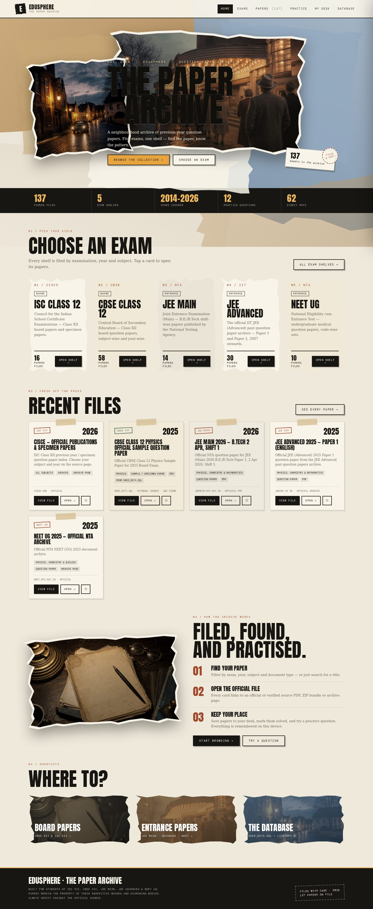

<br>

| 🏠 Home & shelves | 📄 Paper browser | 🗂 Paper drawer |
| :---: | :---: | :---: |
| 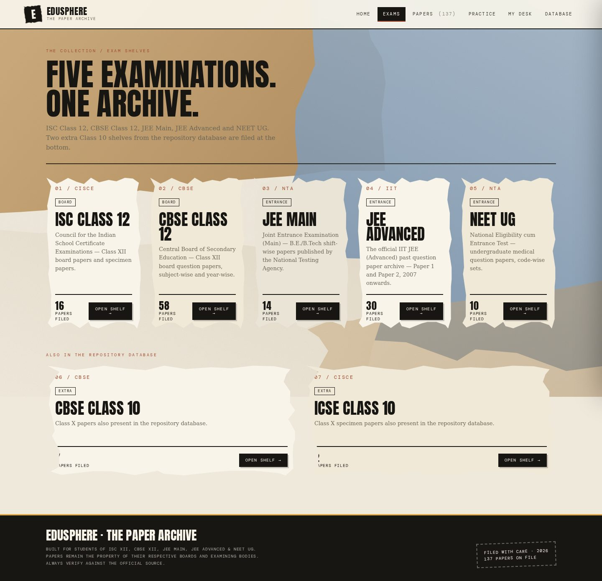 | 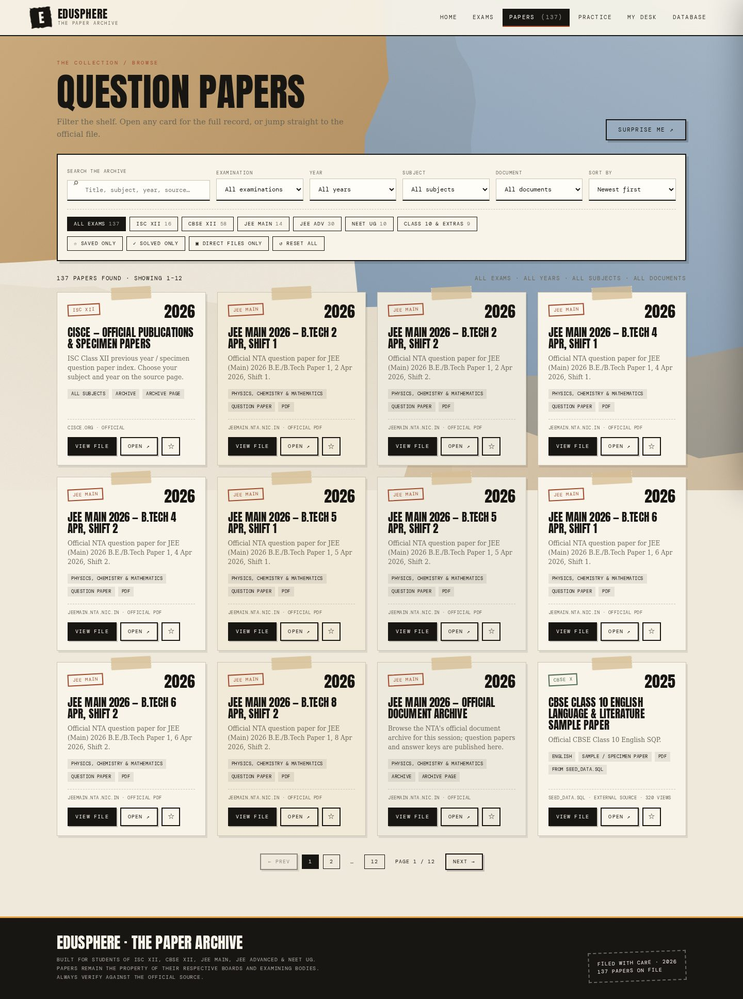 | 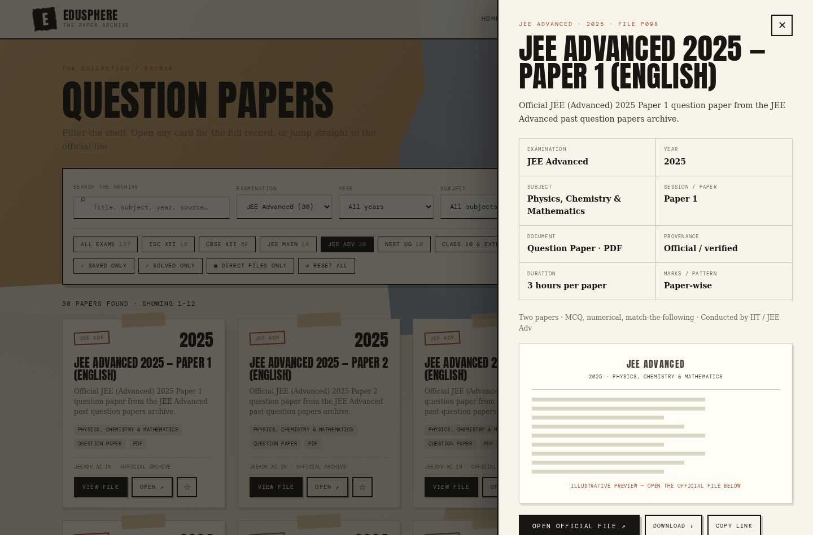 |

</div>

---

## ✨ In one line

> **EduSphere** is a school project that turns scattered, hard-to-find previous-year question papers into a single searchable library — designed so any student can open one file and start revising, with no account, no install and no internet connection required.

**🌐 Try it live:** https://edusphere-paper-archive.vercel.app/ (free Vercel Hobby hosting)

---

## 📌 Table of contents

- [Why this project](#why-this-project)
- [What's inside](#whats-inside)
- [Exam coverage](#exam-coverage)
- [Features](#features)
- [Tech stack](#tech-stack)
- [Repository layout](#repository-layout)
- [Quick start](#quick-start)
- [Database](#database)
- [Documentation](#documentation)
- [Dataset & sources](#dataset--sources)
- [For the viva / project file](#for-the-viva--project-file)
- [Screenshot gallery](#screenshot-gallery)
- [Known limitations](#known-limitations)
- [Credits & disclaimer](#credits--disclaimer)
- [License](#license)

---

## Why this project

Finding a 2019 ISC Physics paper or a 2016 JEE Advanced Paper 2 usually means digging through a dozen sites, dead links, zip bundles and pop-ups. EduSphere solves a small, real problem for students:

| Problem | EduSphere's answer |
| --- | --- |
| Papers scattered across board/NTA sites | **137 papers in one catalogue**, grouped by exam, year, subject and paper type |
| Links rot or are blocked | Every record shows its **source label**, origin (`repo` / `official` / `verified`) and verification state; a **Copy link** button works even inside restricted iframes |
| Sign-ups, paywalls, installs | The whole archive is a **single `index.html`** — double-click and it works offline |
| "Which exam was this for?" | Five exam tiles + filters by exam, year, subject, type and format |
| No way to track revision | Save, mark-solved, personal notes, a dashboard and a small practice quiz |

---

## What's inside

| Folder | What it holds | Runs on its own? |
| --- | --- | --- |
| [`frontend/`](frontend/) | The complete website: a self-contained `index.html`, editable sources in `src/`, build scripts, a local server and a Playwright smoke test | ✅ Yes — open `index.html` directly |
| [`backend/`](backend/) | FastAPI application, five official-site discovery/sync scripts, requirements and corrected documentation | ✅ With env vars + Postgres |
| [`database/`](database/) | Reconstructed **PostgreSQL schema**, a converted Postgres seed, and the original SQLite-style seed from the backend repository | ✅ `.sql` files, ready to run |
| [`docs/`](docs/) | Architecture, database design, API reference, setup guide, dataset notes, deployment notes, engineering review and 14 screenshots | 📖 Documentation |
| [`docs/ci/`](docs/ci/) | A ready-to-use GitHub Actions workflow (copy to `.github/workflows/` to enable) | 🤖 Automation |

---

## Exam coverage

| Examination | Papers in catalogue | Notes |
| --- | ---: | --- |
| **ISC Class 12** | 16 | CISCE specimen papers, AglaSem mirrors, official publications |
| **CBSE Class 12** | 58 | Official CBSE SQP + marking schemes, 12 subjects, 2022–2025 |
| **JEE Main** | 14 | NTA 2026 shift papers + archive links |
| **JEE Advanced** | 30 | Official `jeeadv.ac.in` papers 2007–2025, Papers 1 & 2, English/Hindi, AAT |
| **NEET UG** | 10 | NTA archive + verified code-wise papers |
| *CBSE Class 10* | 7 | Included as a bonus shelf |
| *ICSE Class 10* | 2 | Included as a bonus shelf |
| **Total** | **137 papers** | plus **12 practice questions** |

Dataset origins: **30** records come verbatim from the backend's `seed_data.sql`, **94** from official board/NTA sources and **13** from independently verified indexes. Formats: 62 PDF, 42 ZIP bundles, 33 archive/index pages.

---

## Features

**Frontend**
- 🗂 **Six views** — Home, Exams, Papers, Practice, My Desk, Database — with hash-based routing and working back/forward navigation
- 🔎 **Search + filters** — exam chips, year, subject, paper type, format, sort order, saved/solved/direct-file toggles, pagination
- 🎲 **Surprise me** — jump to a random paper
- 📑 **Paper drawer** — full metadata, Previous/Next navigation, Open / Download / Copy link / Save / Mark as solved
- 🧠 **Practice quiz** — 12 questions with explanations (2 verbatim from the backend's `mock_tests` table, 10 clearly labelled illustrative)
- 📊 **My Desk** — saved papers, solved progress, personal notes
- ➕ **Add locally** — add your own paper, export/import the whole catalogue as JSON
- 🔌 **Optional API connect** — point the frontend at the FastAPI backend and sign in as admin
- 📴 **Zero external requests** — fonts, photos, CSS, JS and the database are all embedded; works offline and with no CDN
- ♿ Responsive down to mobile, with a high-contrast torn-panel hero for small screens

**Backend**
- ⚡ FastAPI with **46 routes** (41 under `/api`), interactive docs at `/docs`
- 🔐 Admin sign-in with `scrypt` password hashing and HttpOnly session cookies (7-day TTL)
- 🗃 PostgreSQL via `psycopg` 3 and PDF storage in **Supabase Storage** (50 MB limit)
- 🕸 Five discovery/sync modules for CBSE, CBSE sample papers, JEE Main, JEE Advanced and NEET
- 📈 Dashboard/statistics endpoints and paper CRUD

---

## Tech stack

| Layer | Technology |
| --- | --- |
| Frontend | Plain HTML5, CSS3, vanilla JavaScript (ES2020) — no framework, no build step required to *run* it |
| Design | Custom torn-paper collage, Anton / DM Mono / Libre Baskerville (embedded), three generated photographic backdrops |
| Frontend build | Python 3 (`build.py`, `build_data.py`) inlines everything into one HTML file |
| Frontend test | Playwright / headless Chromium (`validate.py`) |
| Backend | Python 3.10+, FastAPI, Uvicorn, `psycopg[binary]` 3, Supabase Python SDK, `requests`, BeautifulSoup |
| Database | PostgreSQL (production), SQLite-flavoured seed (reference) |
| Storage | Supabase Storage for uploaded PDFs |
| Hosting | Vercel Hobby (free, static) — https://edusphere-paper-archive.vercel.app/ |

---

## Repository layout

```
edusphere-website/
├── README.md                  ← you are here (project showcase)
├── REPO_METADATA.md           ← GitHub description, topics & repo settings
├── LICENSE                    ← MIT
├── .gitignore
├── .env.example               ← all backend variables, documented
├── Makefile                   ← one-command shortcuts
├── docker-compose.yml         ← local PostgreSQL for the backend
├── CONTRIBUTING.md
│
├── frontend/
│   ├── index.html             ← ⭐ built, self-contained (open this!)
│   ├── README.md
│   ├── build.py               ← inlines CSS/JS/fonts/images/data
│   ├── build_data.py          ← builds archive.json from sources
│   ├── serve.py               ← python3 serve.py 8080
│   ├── validate.py            ← Playwright smoke test
│   ├── SITE_NOTES.md
│   └── src/
│       ├── index.template.html
│       ├── styles.css
│       ├── tears.css          ← generated torn-edge clip-paths
│       ├── app.js
│       ├── assets/            ← 3 JPEGs + 3 woff2 fonts
│       └── data/              ← archive.json + source datasets
│
├── backend/
│   ├── README.md              ← backend docs (corrected)
│   ├── README.corrected.md    ← reviewed version
│   ├── app.py                 ← FastAPI application
│   ├── *_discovery.py         ← 5 scraper/sync modules
│   ├── requirements.txt
│   ├── requirements.clean.txt ← de-duplicated dependency list
│   ├── .env.example
│   └── seed_data.sql          ← original seed (reference copy)
│
├── database/
│   ├── README.md
│   ├── schema.postgres.sql    ← reconstructed PostgreSQL schema
│   ├── seed_data.postgres.sql ← Postgres-compatible seed
│   └── seed_data.sqlite.sql   ← original SQLite-flavoured seed
│
├── docs/
│   ├── ARCHITECTURE.md        ← system design + Mermaid diagrams
│   ├── DATABASE.md            ← tables, relationships, ER diagram
│   ├── API.md                 ← endpoint reference
│   ├── SETUP.md               ← step-by-step local setup
│   ├── DATASET.md             ← how the 137 papers were assembled
│   ├── PROJECT_REPORT.md      ← viva-ready project synopsis
│   ├── CODE_REVIEW.md         ← engineering review summary
│   ├── DEPLOYMENT.md          ← Vercel hosting details
│   ├── engineering/           ← full review, patch & audit scripts
│   └── screenshots/           ← 14 desktop/mobile screenshots
│
└── docs/ci/ci-example.yml     ← optional CI workflow (see docs/ci/README.md)
```

### Architecture at a glance

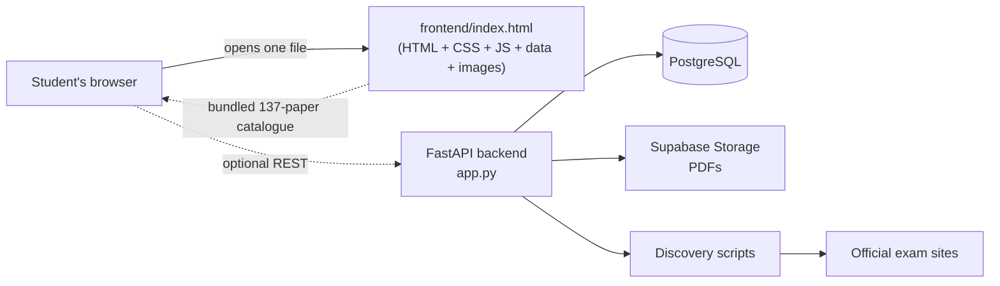

See [`docs/ARCHITECTURE.md`](docs/ARCHITECTURE.md) for the full diagram and data flow.

---

## Quick start

### 1️⃣ Just see the website (0 setup)

```bash
git clone https://github.com/Akash0747/edusphere-website.git
cd edusphere-website/frontend
# double-click index.html, or:
python3 serve.py 8080     # → http://localhost:8080
```

Nothing to install. The site is one 1.5 MB HTML file with everything embedded.

### 2️⃣ Rebuild the frontend from source

```bash
cd frontend
python3 build_data.py     # regenerate src/data/archive.json
python3 build.py          # regenerate index.html
python3 validate.py       # optional: Playwright browser smoke test
```

### 3️⃣ Run the full stack (frontend + backend + database)

```bash
cp .env.example .env      # fill in DATABASE_URL and SUPABASE_* values
docker compose up -d db   # local PostgreSQL
psql "$DATABASE_URL" -f database/schema.postgres.sql
psql "$DATABASE_URL" -f database/seed_data.postgres.sql
cd backend && pip install -r requirements.clean.txt && uvicorn app:app --reload
```

Full instructions, including the optional API-connect screen in the frontend, are in [`docs/SETUP.md`](docs/SETUP.md) and [`backend/README.md`](backend/README.md).

> ⚠️ The backend requires real `DATABASE_URL` + Supabase credentials. It is **not** needed to view the papers — the frontend ships with the whole catalogue already bundled.

---

## Database

The backend repository shipped a SQLite-flavoured seed file but **no schema/migration**, and its SQL uses `INTEGER PRIMARY KEY AUTOINCREMENT`, which PostgreSQL does not accept. This repository fixes that for study purposes:

| File | Purpose |
| --- | --- |
| `database/schema.postgres.sql` | Reconstructed Postgres schema for every table referenced in the code (`admins`, `papers`, `sessions`, `mock_tests`, JEE/NEET/CBSE tables…) |
| `database/seed_data.postgres.sql` | Postgres-compatible seed data |
| `database/seed_data.sqlite.sql` | The original seed, kept verbatim as reference |
| `frontend/src/data/repo-seed.json` | The 30 papers + 2 mock questions parsed out of that seed |
| `frontend/src/data/archive.json` | The final 137-paper / 12-question catalogue |

See [`docs/DATABASE.md`](docs/DATABASE.md) for the ER diagram and column notes.

---

## Documentation

| Document | Read it for |
| --- | --- |
| [`docs/ARCHITECTURE.md`](docs/ARCHITECTURE.md) | System design, request flow, why the frontend is offline-first |
| [`docs/DATABASE.md`](docs/DATABASE.md) | Schema, relationships, PostgreSQL vs SQLite differences |
| [`docs/API.md`](docs/API.md) | Every backend endpoint and its auth requirement |
| [`docs/SETUP.md`](docs/SETUP.md) | Local development, environment variables, troubleshooting |
| [`docs/DATASET.md`](docs/DATASET.md) | How the paper catalogue was collected and verified |
| [`docs/PROJECT_REPORT.md`](docs/PROJECT_REPORT.md) | Ready-to-use synopsis, objectives, outcomes and viva Q&A |
| [`docs/CODE_REVIEW.md`](docs/CODE_REVIEW.md) | What a code review found and how it was addressed |
| [`docs/DEPLOYMENT.md`](docs/DEPLOYMENT.md) | The live Vercel deployment and how to keep it free |
| [`REPO_METADATA.md`](REPO_METADATA.md) | Suggested GitHub description, topics and About settings |

---

## Dataset & sources

- **Official sources:** [jeeadv.ac.in](https://jeeadv.ac.in/archive.html), [cbse.gov.in question papers](https://www.cbse.gov.in/cbsenew/question-paper.html), [jeemain.nta.nic.in](https://jeemain.nta.nic.in/sitemap/), [neet.nta.nic.in](https://neet.nta.nic.in/archive/), CISCE publications and CBSE Academic sample papers.
- **Repository seed:** 30 papers and 2 mock-test questions taken verbatim from `seed_data.sql`.
- **Verified mirrors:** AglaSem, CollegeDunia, Careers360, Aakash, ExamGoal / PracBee indexes, used only where no official file existed and clearly labelled.
- **Link check:** 111 of 123 unique URLs returned HTTP 200; 8 returned 403 (anti-bot / region blocks) and 4 could not be reached. Those records are labelled in the UI as *Link unchecked* / *verified = false*.
- **Honesty labels:** ZIP entries are bundles, archive-page entries are indexes, and 10 of the 12 practice questions are explicitly marked *illustrative — not official*.

---

## For the viva / project file

A complete, school-project-friendly write-up lives in [`docs/PROJECT_REPORT.md`](docs/PROJECT_REPORT.md): problem statement, objectives, methodology, system design, screenshots, results, limitations, future scope and a set of likely viva questions with answers. Highlights:

- **Problem:** previous-year question papers are scattered and hard to access.
- **Solution:** an offline-first catalogue + optional authenticated REST backend.
- **Engineering decisions:** single-file build for zero-dependency delivery; hash routing; progressive enhancement for the API; reconstructed SQL schema; explicit provenance labels for every paper.
- **Results:** 137 papers across 5 target examinations, 0 external requests at runtime, 0 console errors, desktop + mobile verified, deployed free on Vercel Hobby.
- **Learning outcomes:** DOM/state management without a framework, REST API design, SQL schema reconstruction, web scraping etiquette, accessibility, static hosting and CI.

---

## Screenshot gallery

<div align="center">

| | | |
| :---: | :---: | :---: |
| <br/>Home | <br/>Exam shelves | <br/>Paper browser |
| <br/>Paper drawer | 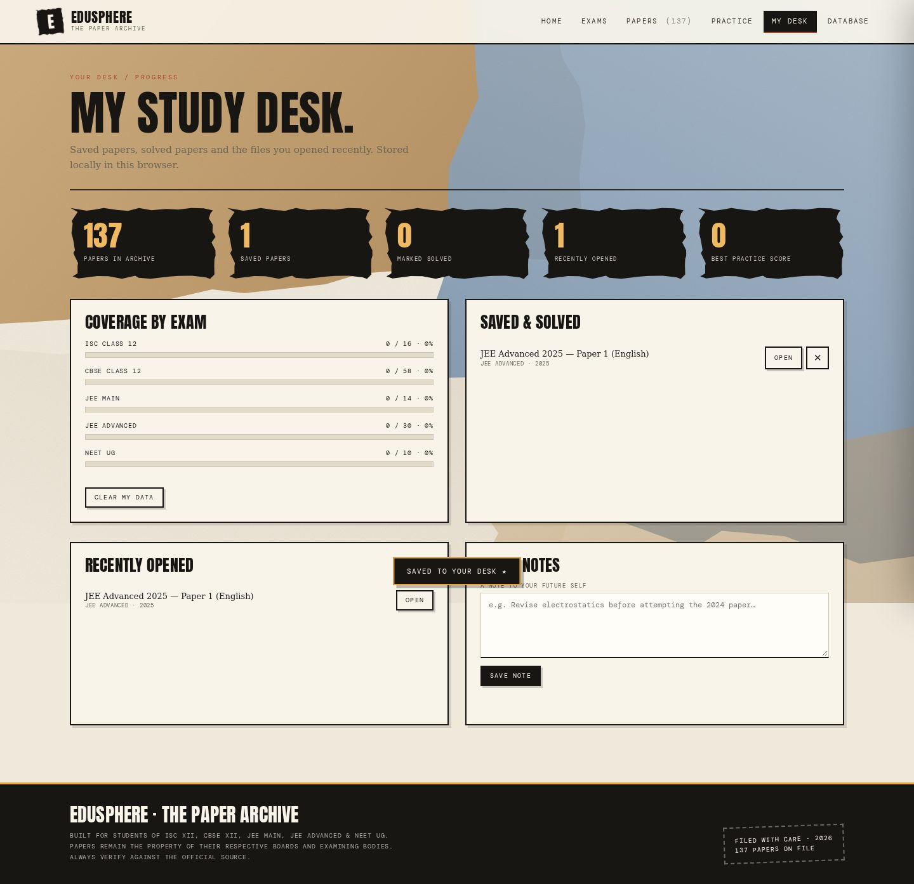<br/>My Desk | 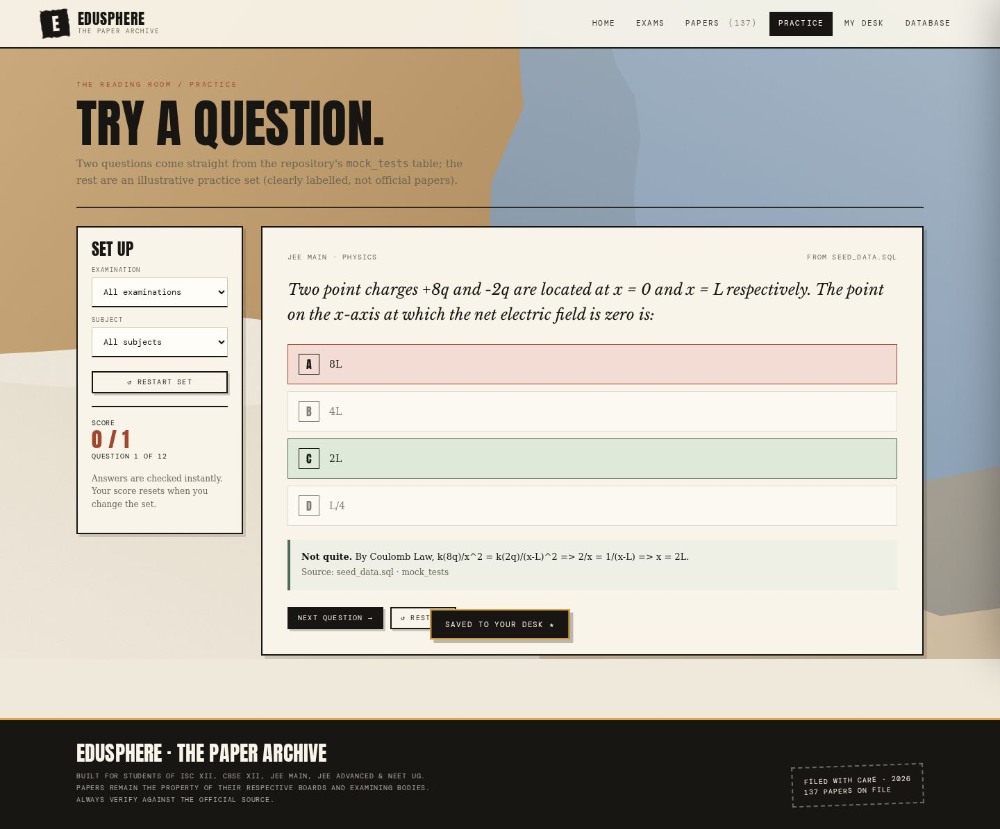<br/>Practice |
| 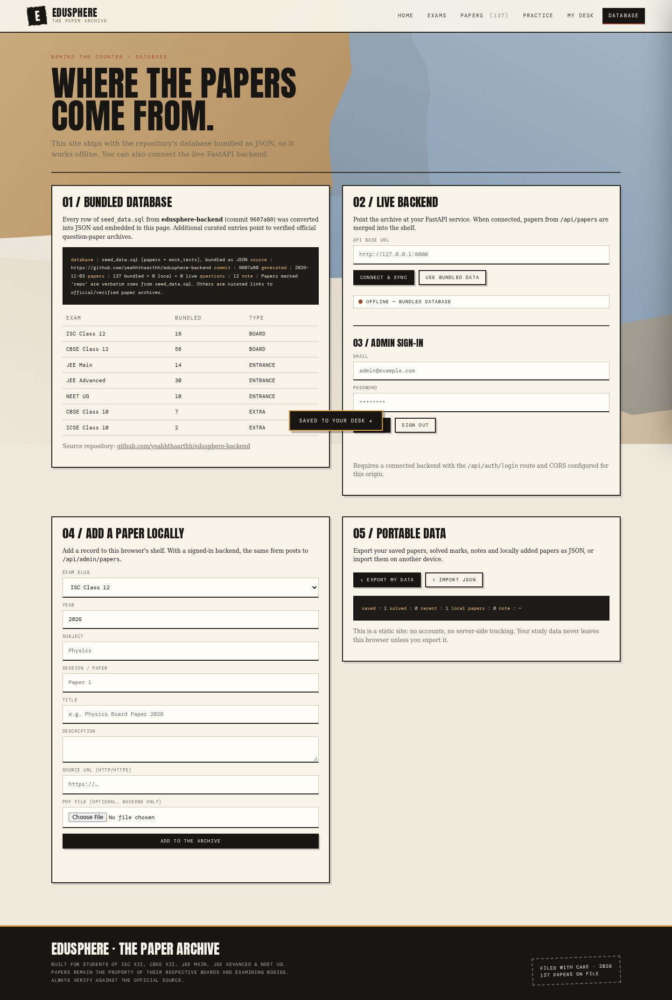<br/>API connect | 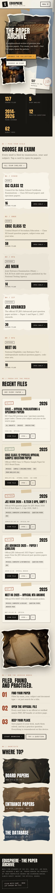<br/>Mobile home | 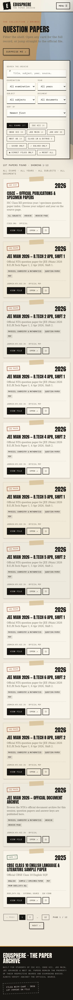<br/>Mobile papers |
| 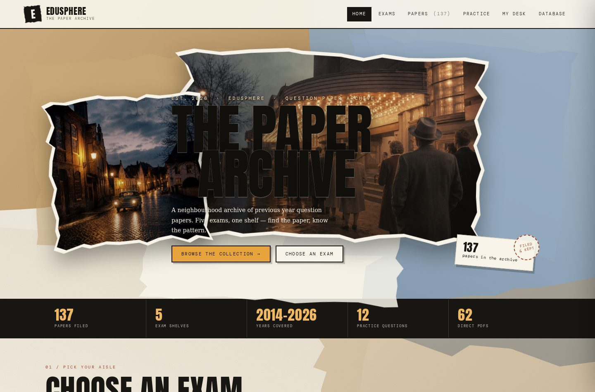<br/>Live on Vercel | 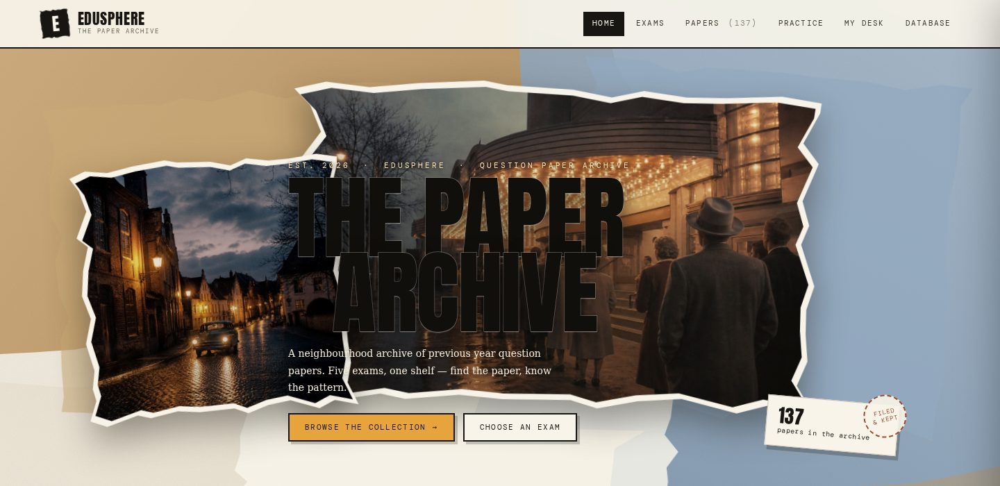<br/>Hero detail | 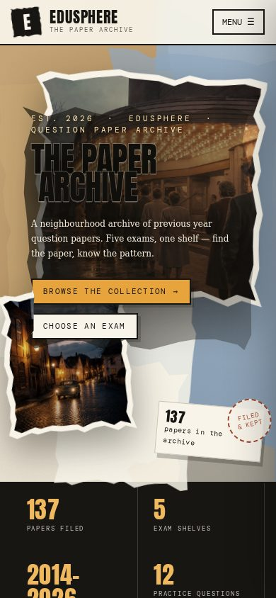<br/>Mobile contrast |

</div>

---

## Known limitations

- Some official URLs answer `403` to automated clients or from outside India; the site shows their verification state instead of hiding them.
- ZIP / archive entries are bundles or index pages, not single PDFs — labelled as such in the UI.
- The frontend's saved papers, notes and solved marks use `localStorage` (per browser); the API-connect screen is optional and needs a running backend.
- The backend code is preserved as received from the original repository. [`docs/CODE_REVIEW.md`](docs/CODE_REVIEW.md) and [`docs/engineering/`](docs/engineering/) document 18 findings (P0/P1/P2) and a proposed, **unapplied** patch — useful as a discussion point, not a claim that the code was rewritten.
- The 10 illustrative practice questions are not official exam questions.

---

## Credits & disclaimer

Built as a **student, non-commercial school project** by [Akash0747](https://github.com/Akash0747). The torn-paper / vintage-cinema visual theme is original; no text from any reference screenshot was copied. All question papers, logos and PDFs remain the property of their respective boards and examining bodies (CISCE, CBSE, NTA, IITs). EduSphere links to them for educational reference and does not host, sell or claim ownership of any paper. Please use it for personal study only.

Hosted free on [Vercel Hobby](https://edusphere-paper-archive.vercel.app/).

---

## License

[MIT](LICENSE) — free to use, modify and present for educational purposes.
