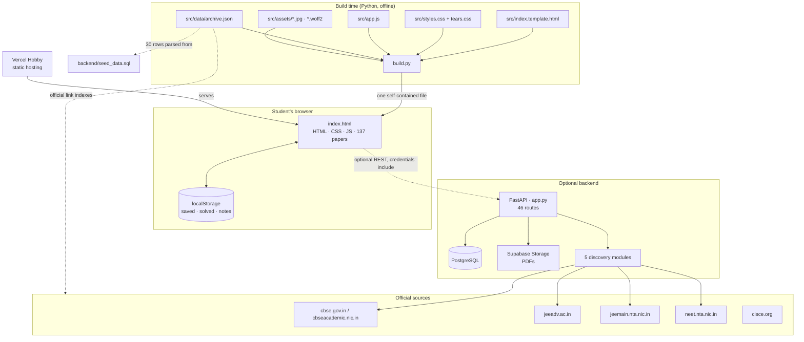

# Architecture

EduSphere is deliberately split into two independent halves. The **frontend is complete on its own**; the backend is an optional, authenticated service for maintaining the catalogue.

## System diagram

## Why offline-first?

A school project should be demoable in a classroom with bad Wi-Fi. Bundling the catalogue into a single HTML file gives:

- **No runtime dependencies** — no CDN, no API, no database, no analytics. Verified: 0 external requests.
- **Reproducible demos** — the same file works from a USB drive, a local server or a static host.
- **A clean separation** — the backend can be down, unconfigured or replaced without the students losing access to the papers.

The "Database" and "Connect" views make the optional backend explicit rather than hiding it.

## Frontend design

| Concern | Approach |
| --- | --- |
| Routing | Hash routing (`#/home`, `#/papers`, …) — works from `file://` and static hosts with no rewrite rules |
| State | A single in-memory `state` object + `localStorage` for personal data; re-render on change |
| Data | `window.__ARCHIVE__` — JSON embedded at build time |
| Views | Six sections rendered by small functions in `app.js`; no framework |
| Styling | CSS custom properties for the kraft/blue/cream palette; `clip-path` torn edges in `tears.css` |
| Assets | Base64 data URIs for 3 JPEGs and 3 woff2 fonts, inlined by `build.py` |
| Responsive | Grid/flex reflow; mobile hero gets a translucent torn panel with light type for contrast |

## Backend design

| Concern | Approach |
| --- | --- |
| API | FastAPI, trailing-slash aliases on most routes, Swagger at `/docs` |
| Auth | `scrypt` hash in `admins`; opaque SHA-256 token in `sessions`; HttpOnly `archive_session` cookie, 7 days |
| Data | PostgreSQL via `psycopg` 3 with `dict_row`; new connection per request |
| Files | Supabase Storage; `get_public_url()` or a 302 to `source_url` |
| Discovery | One module per exam; `requests` + BeautifulSoup; admin-triggered sync endpoints |
| Startup | `init_db()` runs at import time and seeds an admin + 16 starter rows |

## Data flow for a student

1. Open `index.html` → `window.__ARCHIVE__` is already in memory.
2. Choose an exam tile or chip → the Papers view filters the 137 records client-side.
3. Open a paper drawer → metadata, provenance and link actions render immediately.
4. "Open" follows the official `sourceUrl`; "Copy link" works even in restricted iframes.
5. Saved / solved / notes persist in `localStorage`; export/import JSON moves them between browsers.

## Deployment

`index.html` is deployed as a single static asset on Vercel Hobby. See [`DEPLOYMENT.md`](DEPLOYMENT.md) for the exact setup, free-tier constraints and update procedure. An optional CI workflow is supplied at [`ci/ci-example.yml`](ci/ci-example.yml): copy it to `.github/workflows/ci.yml` to rebuild and validate the frontend on every push.
