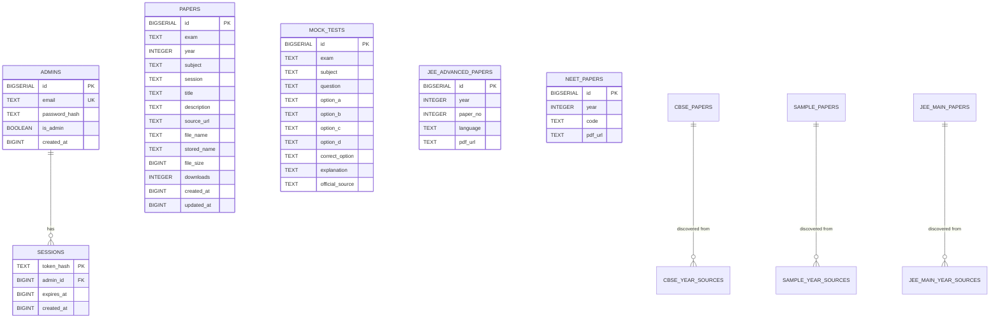

# Database design

> **Context:** the original backend repository had no schema or migration file. `init_db()` only inserts rows, and the shipped `seed_data.sql` is SQLite-flavoured and assumes `papers` already exists. The files in [`../database/`](../database/) were reconstructed from every SQL statement in `app.py` and the five discovery modules. See the caveats in [`../database/README.md`](../database/README.md).

## Entity relationship diagram



## Core tables

### `admins`
| Column | Type | Notes |
| --- | --- | --- |
| `id` | `BIGSERIAL` | Primary key |
| `email` | `TEXT UNIQUE` | Normalised with `clean_email()` |
| `password_hash` | `TEXT` | Python `hashlib.scrypt` output, never plaintext |
| `is_admin` | `BOOLEAN` | Default `TRUE` |
| `created_at` | `BIGINT` | Unix epoch seconds |

### `sessions`
| Column | Type | Notes |
| --- | --- | --- |
| `token_hash` | `TEXT` | SHA-256 of the opaque cookie token (the raw token is never stored) |
| `admin_id` | `BIGINT` | References `admins.id` |
| `expires_at` | `BIGINT` | 7 days from login |
| `created_at` | `BIGINT` | Unix epoch |

### `papers`
The main catalogue. `stored_name = 'EXTERNAL_URL'` marks a row whose file is an external link rather than a Supabase object. `downloads` is a counter, `source_url` is where the file proxy redirects, and the epoch columns are `BIGINT` because the code writes `int(time.time())`.

### `mock_tests`
Multiple-choice practice rows with `correct_option` and `explanation`. Two rows from the original seed were carried into the frontend quiz verbatim; the other ten frontend questions are labelled *illustrative, not official*.

## Discovery tables

Each scraper keeps its own table plus a `*_year_sources` table recording which official index URL was scanned:

| Module | Tables |
| --- | --- |
| `cbse_discovery.py` | `cbse_papers`, `cbse_year_sources` |
| `cbse_sample_discovery.py` | `sample_papers`, `sample_year_sources` |
| `jee_main_discovery.py` | `jee_main_papers`, `jee_main_year_sources` |
| `jee_advanced_discovery.py` | `jee_advanced_papers` |
| `neet_discovery.py` | `public.neet_papers` |

## SQLite → PostgreSQL differences

| Original seed (SQLite) | Postgres schema |
| --- | --- |
| `INTEGER PRIMARY KEY AUTOINCREMENT` | `BIGSERIAL PRIMARY KEY` |
| Implicit column types | Explicit `TEXT` / `INTEGER` / `BIGINT` / `BOOLEAN` |
| Only `CREATE TABLE mock_tests` | Full DDL for all referenced tables |
| `datetime` strings assumed | `BIGINT` unix epoch |
| Runs without a schema | Requires `schema.postgres.sql` first |

## Frontend catalogue vs database

The frontend does **not** query these tables at runtime. At build time:

```
backend/seed_data.sql
   └─(SQLite parse)→ frontend/src/data/repo-seed.json   (30 papers, 2 questions)
official CBSE / JEE Main / JEE Advanced / NEET HTML indexes
   ├→ frontend/src/data/cbse-links.json
   ├→ frontend/src/data/jeemain-links.json
   └→ curated official + verified records
                    ↓ build_data.py
        frontend/src/data/archive.json   (137 papers, 12 questions, 7 shelves)
                    ↓ build.py
              frontend/index.html  (window.__ARCHIVE__)
```

This is why the website works with no database at all, while the repository still contains a complete SQL layer for the backend.
