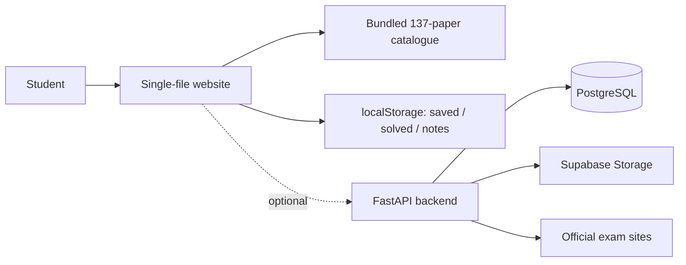

# Project report — EduSphere: The Paper Archive

*A ready-to-adapt synopsis for a school project file, presentation or viva.*

---

## 1. Title

**EduSphere — The Paper Archive**: an offline-first, student-built library of previous-year question papers for ISC Class 12, CBSE Class 12, JEE Main, JEE Advanced and NEET UG.

## 2. Problem statement

Students preparing for board and competitive examinations waste considerable time locating authentic previous-year question papers. Papers are spread across board websites, NTA archives and third-party mirrors; links expire, files arrive as unexplained ZIP bundles, and many portals require sign-ups. There is no single, honestly-labelled place to browse papers by exam, year and subject.

## 3. Objectives

1. Build one catalogue covering the five target examinations.
2. Make it usable without an account, an install, or a working internet connection.
3. Show provenance for every paper so students can judge authenticity.
4. Provide navigation aids: filters, search, saved papers, progress and practice.
5. Include the complete backend and SQL layer so the project can be extended into a full-stack system.
6. Present it professionally: documentation, screenshots, a live demo and a clean repository.

## 4. Methodology

| Phase | Work |
| --- | --- |
| Requirements | Identified the five exams and the need to browse multiple PYQs interactively |
| Data collection | Parsed the backend's `seed_data.sql`; scraped official CBSE / JEE Advanced / JEE Main / NTA NEET indexes; added verified mirrors where no official file existed |
| Data modelling | Normalised every record to a common schema with `origin`, `format`, `verified` and `note`; de-duplicated; checked 123 URLs |
| Frontend design | Torn-paper / vintage-cinema visual theme; six views; hash routing; client-side state; `localStorage` for personal data |
| Build engineering | Python build script inlines CSS, JS, fonts, images and data into one self-contained HTML file |
| Backend | Preserved the FastAPI + PostgreSQL + Supabase Storage service; documented the real stack; reconstructed the missing SQL schema |
| Testing | Playwright smoke test across all views, desktop and mobile; 0 JS errors, 0 external requests |
| Deployment | Published as a static site on Vercel's free Hobby tier |
| Documentation | README, architecture, database, API, setup, dataset, code review, deployment and this report |

## 5. System design

**Key decision — offline-first:** the frontend does not depend on the backend at runtime. This makes the project demoable anywhere and keeps the free hosting simple; the API-connect view makes the optional integration explicit.

## 6. Results

| Metric | Result |
| --- | --- |
| Papers catalogued | **137** across 7 shelves (5 target exams + 2 bonus) |
| Practice questions | **12** (2 official seed + 10 labelled illustrative) |
| Records from the repository seed | 30 papers + 2 mock questions, verbatim |
| Official / verified records | 94 official, 13 verified |
| Unique links checked | 123 (111 × 200, 8 × 403, 4 unreachable) |
| External requests at runtime | **0** |
| JavaScript / console errors | **0** |
| Responsive | Desktop + mobile verified, 14 screenshots |
| Live demo | https://edusphere-paper-archive.vercel.app/ (free) |
| Repository contents | Frontend, backend, PostgreSQL schema + seed, docs, CI, licence |

## 7. Screenshots

See [`screenshots/`](screenshots/) — home, exam shelves, paper browser, drawer, dashboard, practice, API connect, mobile views and the live deployment.

## 8. Learning outcomes

- Structuring a fairly large vanilla-JavaScript application without a framework.
- Client-side state, hash routing, filtering, pagination and persistence.
- Building a reproducible static bundler with Python.
- Reading and reconstructing a SQL schema from application code; understanding SQLite vs PostgreSQL differences.
- Reading a real FastAPI codebase: cookie auth, multipart uploads, storage proxies, scrapers.
- Working with official sources responsibly and labelling uncertainty honestly.
- Accessibility/contrast, responsive layouts, browser testing and static deployment.

## 9. Limitations & future scope

**Limitations:** some official sites block automated/non-Indian clients; ZIP and archive entries are not single PDFs; personal data is per-browser; the backend code is preserved as-is and has documented security findings (see `CODE_REVIEW.md`).

**Future scope:** connect the frontend to a live backend for crowd-sourced corrections; scheduled link health checks; answer-key discussions; a teacher/admin dashboard; full-text search inside PDFs; regional-language papers; a PWA for offline caching; multilingual labels.

## 10. Likely viva questions

**Q. Why not use React / a framework?**
A single static file loads instantly, needs no build toolchain on the user's machine, and works offline. The state is small enough that a framework would add weight without benefit — useful to demonstrate that I understand the underlying DOM/state model first.

**Q. How do you know a paper is genuine?**
Every record stores `origin` (repo / official / verified), `sourceUrl`, `sourceLabel` and a `verified` flag. Official board/NTA URLs are preferred; mirrors are labelled; unreachable links are shown as unverified instead of being silently dropped.

**Q. Why is the database in the HTML file?**
The website is the *presentation* layer and must work in a classroom with no network. The repository still contains the full SQL schema and seed for the backend — the two are kept in sync by `build_data.py`, which parses `backend/seed_data.sql`.

**Q. What was hardest?**
Reconstructing the schema: the backend had no migration file and its seed was SQLite-flavoured, so I inferred every table from the SQL statements in `app.py` and the five scrapers, then produced a PostgreSQL version with `BIGSERIAL` and `BIGINT` epoch columns.

**Q. Is it free to host?**
Yes — it is a single static asset on Vercel Hobby, which is free for personal, non-commercial student projects. No functions, databases, custom domains or paid add-ons are used.

**Q. What would you fix next?**
Apply the reviewed security patch (auth on the two NEET endpoints and the admin aliases, CSRF protection, login rate limiting), add automated link checks in CI, and move `init_db()` into a one-time migration.

## 11. Conclusion

EduSphere turns a scattered, frustrating research task into one calm, offline-capable library. It demonstrates full-stack awareness (frontend, REST backend, SQL, storage, deployment) while keeping the actual student experience dependency-free, honest about sources and pleasant to use.
